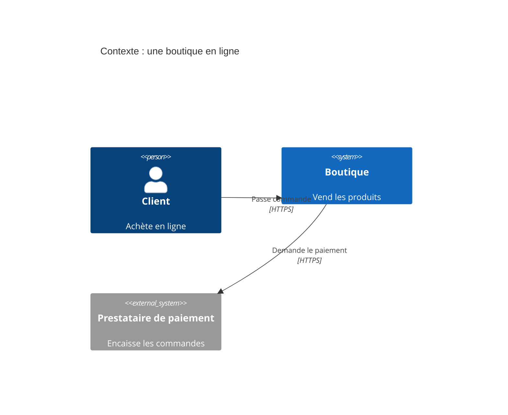
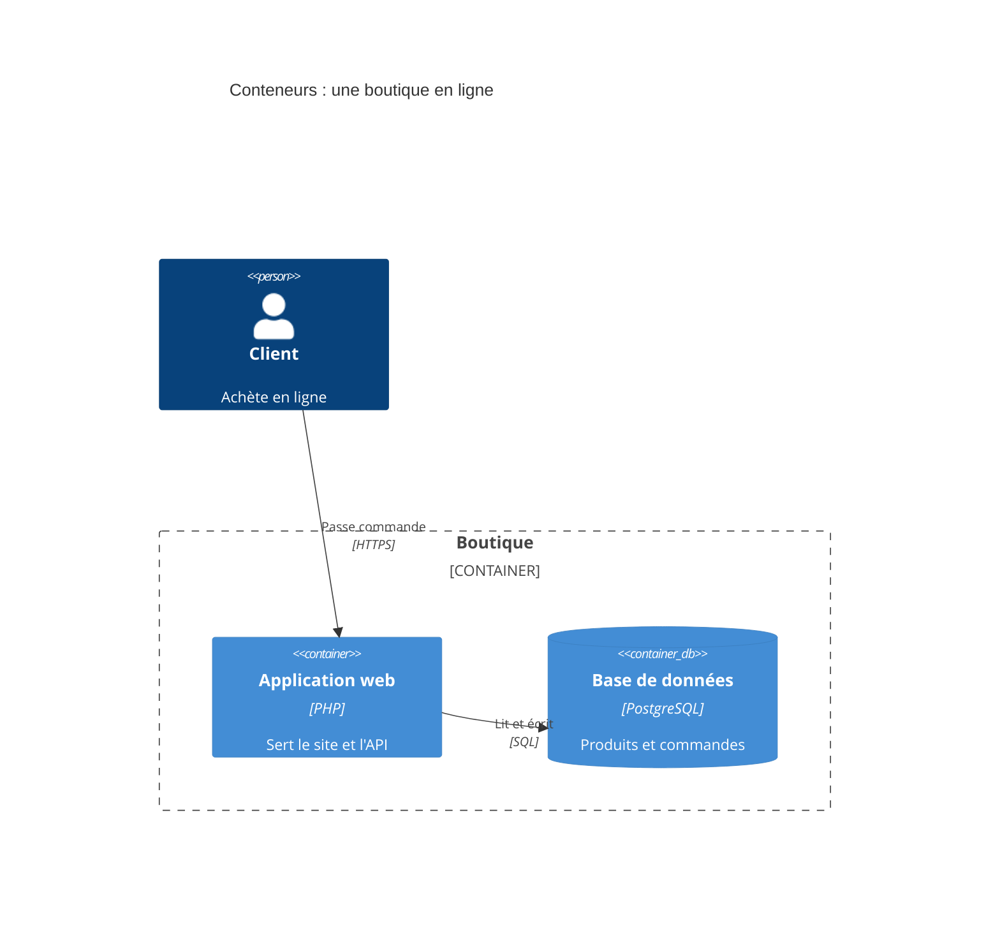

# Atelier 5 : le C4 de la Librairie

**Durée** : 35 min · **Individuel**, sur [mermaid.live](https://mermaid.live) · **Résultat** : `docs/architecture.md` dans votre clone, avec deux diagrammes

## La syntaxe, sur un exemple

Mermaid sait dessiner les vues C4. Voici un exemple minimal, sans rapport avec la Librairie. Collez chaque bloc dans mermaid.live pour le voir.





- `Person(alias, "Nom", "Description")`, `System(...)`, `System_Ext(...)` pour un système externe.
- `Container(alias, "Nom", "Technologie", "Description")`, `ContainerDb(...)` pour une base de données.
- `Rel(de, vers, "Ce qui se passe", "Protocole")`.
- La syntaxe complète : [mermaid.js.org/syntax/c4.html](https://mermaid.js.org/syntax/c4.html).

## Étapes

1. **Le Contexte.** Dessinez la vue C4 Contexte de la Librairie :
   - les personnes : les lecteurs et les libraires ;
   - les agents IA partenaires, qui passent par `/mcp` ;
   - le système : la Librairie ;
   - les systèmes externes : le prestataire de paiement et le service d'envoi d'e-mails.

   *Terminé quand* : chaque personne et chaque système externe a au moins une relation, avec un libellé.

2. **Les Conteneurs.** Dessinez la vue C4 Conteneurs de la Librairie :
   - l'application (FrankenPHP et API Platform), qui expose `/api` et `/mcp` ;
   - PostgreSQL ;
   - le transport Messenger (une table Doctrine dans PostgreSQL) et le worker qui le consomme ;
   - le service Subscription, si votre binôme a choisi l'option B à l'atelier 4.

   Le formateur vous donne votre version :
   - **Version exploitation** : pour l'équipe qui déploie et surveille. Montrez les technologies, les protocoles, où vivent les données, ce qui tourne en continu.
   - **Version direction commerciale** : pour des lecteurs non techniques. Montrez ce que chaque conteneur rend possible pour les clients et pour la vente, avec des mots du métier.

   *Terminé quand* : chaque conteneur a une technologie et une description adaptées à votre public, et chaque relation a un libellé.

3. **Enregistrez.** Créez `docs/architecture.md` dans votre clone. Mettez chaque diagramme dans un bloc ` ```mermaid `, sous un titre (`## Contexte`, `## Conteneurs`). GitHub affiche ces blocs comme des diagrammes.
   *Terminé quand* : le fichier contient les deux blocs, et chacun s'affiche sans erreur dans mermaid.live.

Ne commitez pas encore : l'atelier 6 ajoute un lien vers l'ADR, puis commite.
