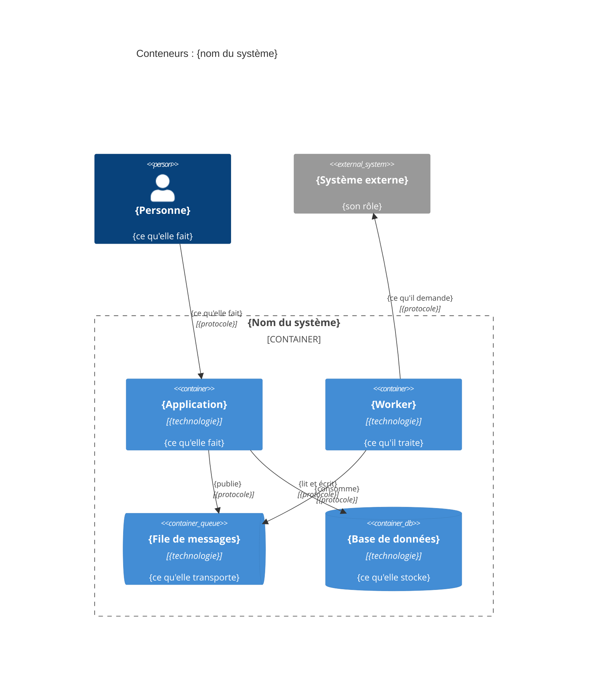

# Vue C4 Conteneurs (Mermaid)

Ce qui se déploie et se lance à part : applications, bases de données, files de messages, workers. Chaque conteneur a une technologie.

À coller dans [mermaid.live](https://mermaid.live), ou dans un bloc ` ```mermaid ` d'un fichier Markdown : GitHub l'affiche comme un diagramme.

## Modèle à copier



## Syntaxe

- `Container(alias, "Nom", "Technologie", "Description")` ; `Container_Ext(...)` pour un conteneur externe.
- `ContainerDb(...)` pour une base de données, `ContainerQueue(...)` pour une file de messages.
- `Container_Boundary(alias, "Nom") { ... }` regroupe les conteneurs d'un même système.
- `Rel(de, vers, "Libellé", "Technologie")`.
- Référence : [mermaid.js.org/syntax/c4.html](https://mermaid.js.org/syntax/c4.html).
