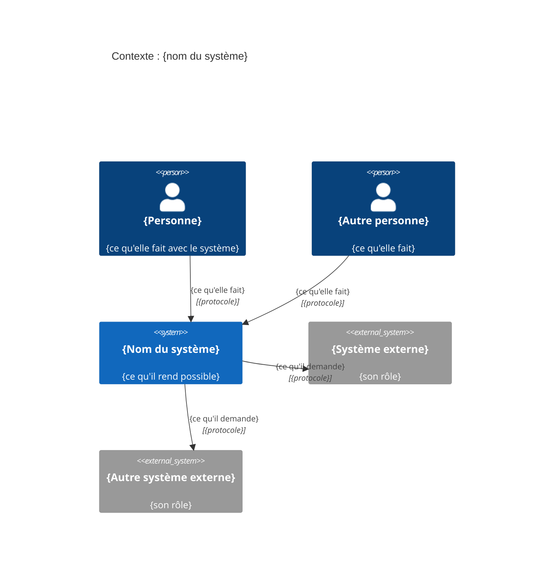

# Vue C4 Contexte (Mermaid)

Le système au centre, les personnes qui l'utilisent, les systèmes externes avec lesquels il échange. Pas de technologie ici.

À coller dans [mermaid.live](https://mermaid.live), ou dans un bloc ` ```mermaid ` d'un fichier Markdown : GitHub l'affiche comme un diagramme.

## Modèle à copier



## Syntaxe

- `Person(alias, "Nom", "Description")` ; `Person_Ext(...)` pour une personne extérieure.
- `System(alias, "Nom", "Description")` ; `System_Ext(...)` pour un système externe.
- `Rel(de, vers, "Libellé", "Technologie")` ; le dernier argument est facultatif.
- Référence : [mermaid.js.org/syntax/c4.html](https://mermaid.js.org/syntax/c4.html).
